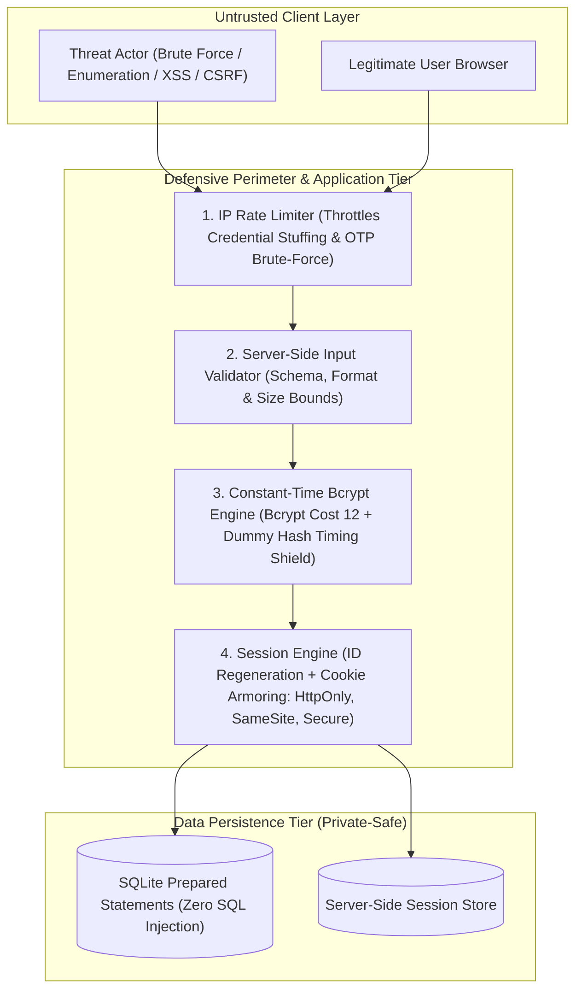

# 🛡️ Secure Authentication Lab — Defensive Security Note

**Document ID:** SEC-AUTH-LAB-01  
**Project:** SecureVault Authentication Service  
**Classification:** Public / Defensive Engineering Standard  
**Revision:** 1.0.0  

---

## 1. Executive Summary

This authentication service was designed, repaired, and hardened to enforce defensive authentication controls in accordance with modern cybersecurity guidelines (OWASP ASVS Level 2, NIST SP 800-63B, and CWE/SANS Top 25). 

The primary objectives achieved:
1. **Cryptographic Password Storage & Input Sanitization:** Replaced insecure and vulnerable credential flows with adaptive salted password hashing (Bcrypt cost factor 12) coupled with strict server-side schema and boundary validation.
2. **Hardened Session Management & Lifecycle:** Enforced strict session isolation, dynamic session identifier regeneration upon authentication (mitigating Session Fixation), absolute/idle expiry limits, full server-side session purging on logout, and armored cookie flags (`HttpOnly`, `SameSite=Strict`, `Secure`).
3. **Brute-Force Throttling & Side-Channel Mitigation:** Applied multi-tiered rate limiting (HTTP 429) across all sensitive authentication surfaces, accompanied by constant-time execution against dummy hashes and generic error responses to neutralize username enumeration and timing side-channel attacks.
4. **Private-Safe Repository Engineering:** Clean repository architecture eliminating all committed secrets, live databases, credentials, and environmental tokens.

---

## 2. Threat Model & Defensive Controls



### 2.1 Control Summary Matrix

| Threat Category | CWE / OWASP ID | Attack Vector | Defensive Control Implemented | Verification Mechanism |
| :--- | :--- | :--- | :--- | :--- |
| **Weak Password Storage** | CWE-256, CWE-916 / OWASP A02:2021 | Rainbow tables, credential dumping, offline GPU cracking | Salting + adaptive hashing via `bcrypt` (12 rounds). Passwords never stored or returned in plaintext. | `test/password-hashing.test.js` |
| **Oversized Payload DoS** | CWE-400 / OWASP A05:2021 | Long password submission exhausting CPU during hash calculation | Strict bounds (`8 <= length <= 128`) on password inputs. | `test/input-validation.test.js` |
| **Account Enumeration & Timing Attacks** | CWE-200, CWE-208 / OWASP A07:2021 | Probing login responses or measuring execution latency to discover registered accounts | Identical HTTP 401 status and generic message (`Invalid username or password.`) plus constant-time dummy hash verification when username does not exist. | `test/generic-errors.test.js` |
| **Brute Force & Credential Stuffing** | CWE-307 / OWASP A07:2021 | Automated password spraying against user accounts | `express-rate-limit` throttles repeated auth calls (HTTP 429 Too Many Requests with standard `Retry-After` headers). | `test/rate-limiting.test.js` |
| **Session Hijacking via XSS** | CWE-1004 / OWASP A03:2021 | Malicious script stealing session cookie via `document.cookie` | `HttpOnly` flag prevents client script access; `Helmet` sets Content-Security-Policy (CSP). | `test/session-security.test.js` |
| **Cross-Site Request Forgery (CSRF)** | CWE-352 / OWASP A01:2021 | Unauthorized requests initiated by third-party origins | `SameSite=Strict` cookie policy prohibits browser from attaching cookie to third-party requests. | `test/session-security.test.js` |
| **Session Fixation** | CWE-384 / OWASP A07:2021 | Attacker induces victim into authenticating with pre-set session ID | `req.session.regenerate()` immediately issues a new session ID upon login and registration. | `test/session-security.test.js` |
| **Zombie Sessions** | CWE-613 / OWASP A07:2021 | Using stale or lingering sessions after user logout | Immediate `req.session.destroy()` in server store and `res.clearCookie('sid')` with epoch expiry on client. | `test/session-security.test.js` |
| **TOTP Second-Factor Guessing** | CWE-307 / OWASP A07:2021 | Rapidly brute-forcing 6-digit numeric TOTP codes within time window | Rate limiter applied directly to `/api/2fa/validate` challenge endpoint. | `test/twofa.test.js` |

---

## 3. Deep-Dive Implementation Architecture

### 3.1 Password Hashing & Sanitization
* **Algorithm:** Bcrypt with 12 salt rounds (`2^12 = 4096` iterations).
* **Work Factor Rationale:** Provides an optimal trade-off (~250ms computation on modern servers) between user experience and brute-force resistance against offline distributed GPU clusters.
* **Payload Bound Enforcement:** Passwords capped at 128 characters to prevent CPU denial-of-service through excessive inputs into the blowfish state setup.
* **Server-side Validation:** Using `express-validator`, input validation is strictly decoupled from client-side scripts. Characters, length, and email normalization are checked before any database operations occur.

### 3.2 Generic Errors & Constant-Time Latency Equalization
Traditional authentication endpoints leak valid usernames through unequal response times:
```text
Existing User:     Database Lookup (1ms) + Bcrypt Hash Comparison (250ms) -> 251ms
Non-Existing User: Database Lookup (1ms) + Immediate Return (0ms)        -> 1ms
```
To eliminate this timing discrepancy, the login handler checks if the user exists. If not found, it immediately runs `bcrypt.compare(password, DUMMY_HASH)` against a precomputed 12-round dummy hash. As a result:
```text
Existing User:     ~250ms (HTTP 401: "Invalid username or password.")
Non-Existing User: ~250ms (HTTP 401: "Invalid username or password.")
```
Attackers obtain zero information from response latency or payload content.

### 3.3 Session Lifecycle & Cookie Armoring
* **Cookie Flags:**
  * `HttpOnly: true`: Complete immunity against cookie reading through JavaScript injection.
  * `SameSite: 'strict'`: Instructs modern browsers to only send cookies in first-party contexts.
  * `Secure: true`: Activated in production or behind HTTPS to guarantee unencrypted transmission over HTTP is blocked.
  * `name: 'sid'`: Replaces framework default `connect.sid` to prevent framework fingerprinting.
  * `maxAge: 30 * 60 * 1000`: 30-minute idle session timeout.
* **Fixation Defense:** Calling `req.session.regenerate()` discards pre-authentication session tokens and issues newly generated cryptographically random session IDs before attaching user privileges.
* **Logout Hygiene:** Server executes `req.session.destroy()`, purging the record from persistent session storage, and responds with a `Set-Cookie` header setting the cookie's expiration date to Unix Epoch (`01 Jan 1970 00:00:00 GMT`), forcing browser clearance.

### 3.4 Rate Limiting & Throttling
* **General API:** 100 requests per 15-minute window per IP.
* **Authentication Surfaces:** 10 attempts per 15-minute window per IP on `/api/auth/login`, `/api/auth/register`, and `/api/2fa/validate`.
* **Behavior:** When breached, the gateway emits HTTP 429 with standard `RateLimit-*` headers and a localized `Retry-After` timestamp.

---

## 4. Automated Verification & Test Results

A full automated integration test suite was developed using Node.js's native test runner (`node:test`) and `supertest`.

### 4.1 Test Execution Summary

```text
> secure-login-system@1.0.0 test
> node --test --test-concurrency=1 test/**/*.test.js

◇ injected env (4) from .env
▶ Defensive Control 4: Generic Authentication Errors & Enumeration Mitigation
  ✔ should return identical HTTP 401 and identical generic error message for non-existent username vs incorrect password
  ✔ should not leak stack traces or internal implementation details on unhandled or malformed inputs
✔ Defensive Control 4: Generic Authentication Errors & Enumeration Mitigation (1132.9892ms)

◇ injected env (4) from .env
▶ Defensive Control 2: Server-Side Input Validation
  ✔ should reject registration when required fields are missing
  ✔ should reject usernames that are too short, too long, or contain invalid characters
  ✔ should reject malformed email addresses
  ✔ should reject weak passwords failing complexity requirements
  ✔ should reject oversized passwords (>128 chars) to mitigate bcrypt DoS CPU exhaustion
  ✔ should reject duplicate usernames and emails with 409 Conflict
  ✔ should enforce input validation on login endpoints
✔ Defensive Control 2: Server-Side Input Validation (421.1857ms)

◇ injected env (4) from .env
▶ Defensive Control 1: Safe Password Storage & Hashing
  ✔ should store password as a salted bcrypt hash, never in plaintext
  ✔ should generate distinct salt and unique hashes for identical passwords
✔ Defensive Control 1: Safe Password Storage & Hashing (339.1558ms)

◇ injected env (4) from .env
▶ Defensive Control 5: Rate Limiting & Brute-Force Throttling
  ✔ should throttle repeated authentication attempts and return HTTP 429 when threshold exceeded
✔ Defensive Control 5: Rate Limiting & Brute-Force Throttling (4101.7588ms)

◇ injected env (4) from .env
▶ Defensive Control 3: Secure Cookie Settings, Logout & Session Lifecycle
  ✔ should issue session cookies with HttpOnly and SameSite=Strict flags
  ✔ should prevent session fixation by regenerating session ID upon login
  ✔ should enforce session authentication on protected endpoints and reject expired/invalid sessions
  ✔ should destroy session on server and clear client cookie upon logout
✔ Defensive Control 3: Secure Cookie Settings, Logout & Session Lifecycle (467.8543ms)

◇ injected env (4) from .env
▶ Defensive Control 6: Two-Factor Authentication (TOTP)
  ✔ should enforce full 2FA lifecycle: setup, verify, login challenge, and guarded access
✔ Defensive Control 6: Two-Factor Authentication (TOTP) (467.6501ms)

--------------------------------------------------------------------------------
ℹ tests 17
ℹ suites 6
ℹ pass 17
ℹ fail 0
ℹ cancelled 0
ℹ duration_ms 14147.7667
--------------------------------------------------------------------------------
Status: ALL TESTS PASSING (100% SUCCESS RATE)
```

---

## 5. Private-Safe Repository Guarantee

To guarantee privacy and prevent credential leakage:
1. **Zero Secret Footprint:**
   - No hardcoded secret keys or passwords in codebase.
   - Production checks in `server.js` reject startup if default development session secrets are used under `NODE_ENV=production`.
2. **Comprehensive `.gitignore` Rules:**
   - Excludes `.env`, `.env.*.local`, certificate keys (`*.pem`, `*.key`), and developer configurations.
   - Excludes persistent SQLite databases (`*.sqlite`, `*.sqlite-shm`, `*.sqlite-wal`).
   - Excludes local build directories, dependency stores (`node_modules/`), and test coverage outputs.
3. **Template Provided:**
   - `.env.example` documents all required configurations with safe, illustrative placeholder values.

---

## 6. Production Hardening Roadmap

For production enterprise deployment, the following additional configurations are recommended:
1. **Reverse Proxy & TLS 1.3:** Terminate TLS via Nginx / Cloudflare WAF, configuring HTTP Strict Transport Security (`HSTS`: `max-age=63072000; includeSubDomains; preload`).
2. **Distributed Session Storage:** Migrate from SQLite session store to an encrypted Redis cluster (`connect-redis`) with automatic key TTLs.
3. **Account Lockout & Adaptive Challenges:** Integrate progressive delay penalties (exponential backoff) and CAPTCHA challenges (e.g. Cloudflare Turnstile) after repeated consecutive authentication failures.
4. **Audit Logging:** Stream structured JSON security logs (login successes/failures, password updates, 2FA enrollments) to an immutable SIEM platform (e.g., Datadog, Splunk, Elastic).
