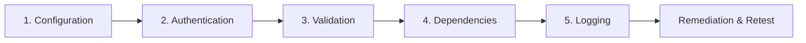

# Defensive Security Assessment: Scoping, Authorization Statement & Rules of Engagement

**Target Application:** SecureVault Local Authentication & Session Management Service (`secure-login-system`)  
**Assessment Type:** Authorized Defensive White-Box Application Security Assessment (Capstone)  
**Assessment Date:** 2026-10-11  
**Operating Environment:** Local Isolated Sandbox (`127.0.0.1:3000` / Node.js Runtime)  
**Standard Compliance:** OWASP Web Security Testing Guide (WSTG v4.2), NIST SP 800-115, NIST SP 800-63B  

---

## 1. Executive Scoping & Architecture Inventory

### 1.1 In-Scope Target Components
The assessment scope encompasses all software artifacts, runtime configurations, persistence layers, and dependency trees belonging to the local authentication repository:

| Component Category | Target Path / Identifier | Assessment Scope & Description |
| :--- | :--- | :--- |
| **Ingress & Configuration** | `server.js`, `.env.example`, `.env` | HTTP security headers (Helmet CSP, HSTS, Referrer-Policy), reverse proxy trust, JSON parser body limits, environmental secret bootstrapping. |
| **Authentication Routes** | `routes/auth.js` (`/api/auth/*`) | Registration, login flow, password hashing work factor, constant-time verification timing defense, session issuance, logout cookie clearance. |
| **Multi-Factor (2FA/TOTP)**| `routes/twofa.js` (`/api/2fa/*`) | TOTP enrollment (`/setup`), token activation (`/verify`), step-2 challenge validation (`/validate`), session fixation mitigation, replay protection, disablement (`/disable`). |
| **Persistence Tier** | `db/database.js`, SQLite databases | Parameterized query defenses (SQLi), credential storage formats (bcrypt salts), encryption-at-rest for sensitive 2FA secrets. |
| **Middleware & Guards** | `middleware/auth.js`, `middleware/logger.js` | Session state guards (`requireAuth`, `requireFullAuth`), structured defensive audit logging, data sanitization filters. |
| **Software Supply Chain** | `package.json`, `package-lock.json`, `node_modules` | Automated CVE analysis, transitive dependency vulnerability audit, resolution of known advisories. |
| **Automated Verification** | `test/**/*.test.js` | Automated regression test suites, unit verification of cryptographic controls, end-to-end security assertions. |

### 1.2 Out-of-Scope Components & Boundaries
To preserve local system integrity and adhere to ethical standards, the following boundaries are strictly enforced:
- **Host Operating System & Physical Infrastructure:** Host Windows kernel, registry, external device drivers, and system BIOS/UEFI.
- **External Network Assets:** External CDNs (`fonts.googleapis.com`, `fonts.gstatic.com`), public DNS resolvers, or third-party web services.
- **Volumetric Denial-of-Service:** Flooding local network interfaces or resource-exhaustion attacks intended to destabilize the developer host workstation.

---

## 2. Formal Authorization Statement

### 2.1 Statement of Authority
This security evaluation is an authorized, defensive assessment conducted internally on developer-owned local applications within an isolated environment. The assessor has explicit permission to inspect, audit, execute automated tests, identify security weaknesses, implement source-code patches, and retest the target system.

### 2.2 Ethical Commitment
The assessment was carried out in full compliance with cybersecurity ethics and defensive principles:
1. **Zero Real Credentials:** No live user accounts, production passwords, API tokens, or actual personal identifiable information (PII) were utilized or exposed. All tests employ synthetic test fixtures (e.g., `crypto_user`, `mfa_user`, RFC 2606 `user@example.com`).
2. **Defensive Intent:** All findings and proof-of-concept tests are designed strictly to validate weaknesses, motivate defensive patches, and verify remediation efficacy without generating offensive or weaponized payloads.
3. **Reproducibility with Safeguards:** All documented findings are reproducible exclusively through unit/integration test cases within the local development sandbox.

---

## 3. Rules of Engagement (RoE)

| Rule # | Parameter | Directive & Operational Boundary |
| :---: | :--- | :--- |
| **RoE-01** | **Testing Modality** | White-box source code audit, automated dependency scanning, and programmatic API testing via Supertest. |
| **RoE-02** | **Target IP & Port** | Bound exclusively to `127.0.0.1:3000` or in-memory Supertest server instances. Outbound internet attacks are prohibited. |
| **RoE-03** | **Data Sanitization** | Logs, test outputs, and assessment reports must redact secrets, hashes, and session cookies. No persistent real user data is stored. |
| **RoE-04** | **Reversibility** | Database tests must execute against isolated, ephemeral test databases (`test_app.sqlite`, `test_sessions.sqlite`) with automated setup and teardown. |
| **RoE-05** | **Remediation Mandate** | Every confirmed Critical and High severity finding must have a corresponding defensive patch, git commit, and automated verification retest. |

---

## 4. Assessment Methodology & Evaluation Domains

The evaluation was executed across the five fundamental defensive security domains:

1. **Domain 1: Configuration Testing:** Evaluated HTTP security headers (Helmet CSP, Referrer-Policy), reverse proxy configuration, request payload limits, and environment secret handling.
2. **Domain 2: Authentication Testing:** Audited password hashing parameters (bcrypt rounds), timing attack mitigations, session fixation protections, 2FA lifecycle, OTP replay vulnerabilities, and sensitive secret storage at rest.
3. **Domain 3: Input Validation Testing:** Evaluated schema validation on registration and authentication endpoints, type confusion, oversized payloads, and malformed body parsing error handling.
4. **Domain 4: Dependency Security Testing:** Analyzed the dependency graph for known public CVEs, supply chain exposures, and outdated libraries via npm audit.
5. **Domain 5: Logging & Monitoring Testing:** Inspected audit trails for security-relevant events (failed logins, rate limit throttling, MFA actions), log formatting, and verification of zero sensitive credential leakage.
