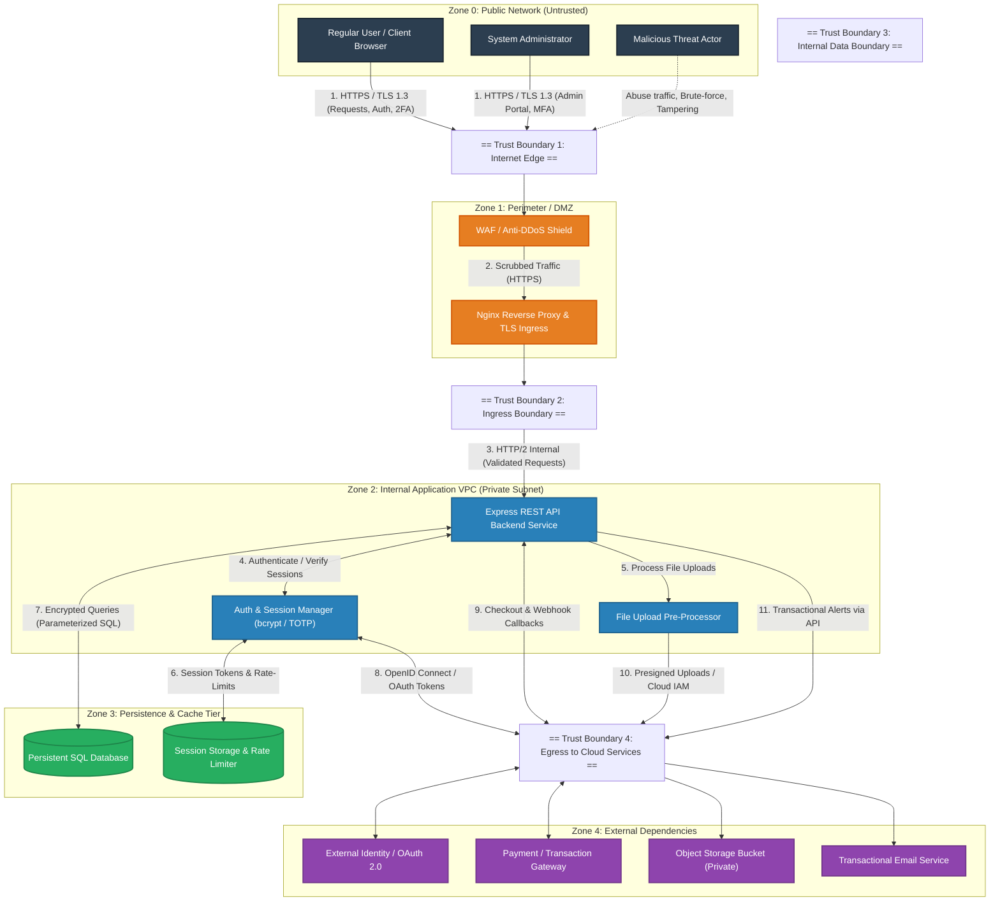

# 🛡️ Cyber Security Task-1: Threat Model and Secure Configuration
**Platform / Course:** Edvyro Cyber Security  
**Repository:** [Threat-Model-and-Secure-Configuration-edvyro-](https://github.com/ammirajukarthikeya-cyber/Threat-Model-and-Secure-Configuration-edvyro-)  
**Target Application:** SecureVault / TaskPulse Web Application  
**Author:** ammirajukarthikeya-cyber  
**Status:** Approved for Hardening Implementation  

---

## 📌 Executive Summary & Scope

This project implements a complete Threat Model, STRIDE Risk Analysis, Prioritized Hardening Plan, and an accompanying production-ready hardened Node.js/Express web application featuring parameterized queries, strict session security, rate-limiting, and Two-Factor Authentication (2FA).

### Core Assets Under Protection
| Asset ID | Asset Name | Description & Classification | Primary Security Goals |
| :--- | :--- | :--- | :--- |
| **A-01** | **Customer PII & Credentials** | User emails, bcrypt password hashes (12 rounds), sessions | Confidentiality, Integrity |
| **A-02** | **TOTP Secrets & 2FA State** | Base32 TOTP secret keys, QR code payloads, multi-factor verification flags | Confidentiality, Authenticity |
| **A-03** | **Application Business Data** | Proprietary user tasks, records, profile metadata, uploaded attachments | Confidentiality, Integrity, Availability |
| **A-04** | **API Signing Keys & Session Secrets** | Express session secrets, JWT signing keys, cloud IAM credentials | Confidentiality, Authenticity |
| **A-05** | **Application Infrastructure** | Server runtime, database engines, network routes, DNS records | Availability, Integrity |

---

## 🗺️ 1. Architecture & Data Flow Diagram (DFD Level 1)

### Trust Boundaries & Actors
The architecture spans four distinct trust zones separated by five Trust Boundaries (**TB1** through **TB5**):
- **Zone 0 (Untrusted Public Network):** Web browsers, unauthenticated visitors, attackers, and authenticated customers.
- **Zone 1 (Perimeter / DMZ):** Cloudflare WAF / Reverse Proxy terminating public TLS.
- **Zone 2 (Internal Compute VPC):** Application service containers running in private subnets with strictly controlled ingress.
- **Zone 3 (Isolated Data Tier):** Persistent database and session cache restricted to internal VPC security groups.
- **Zone 4 (External Third Parties):** Partner clouds and external APIs accessed via outbound HTTPS with strict TLS verification.

### Level 1 Data Flow Diagram



---

## ⚠️ 2. Realistic Abuse Cases & Threat Scenarios

### Abuse Case 1: Broken Object-Level Authorization (BOLA / IDOR)
- **Actor:** Authenticated User of Tenant A (`tenant_id = 101`).
- **Mechanism:** The user requests `GET /api/v1/records/9924` by modifying the sequential numeric ID in the URL parameter.
- **Vulnerability:** The application verifies authentication but fails to verify record ownership against the active session's tenant ID.
- **Impact:** Unauthorized exposure of private documents, profile data, and records across accounts.

### Abuse Case 2: Credential Stuffing & Distributed Password Spraying
- **Actor:** External Cybercriminal using compromised botnets.
- **Mechanism:** Automated scripts attempt thousands of credential pairs against `/api/v1/auth/login`.
- **Vulnerability:** Absence of distributed IP rate limiting, CAPTCHA challenges after repeated failures, or breached-credential detection.
- **Impact:** Account takeover (ATO) of privileged administrators, enabling data exfiltration and fraud.

### Abuse Case 3: Malicious File Upload & Remote Code Execution / Stored XSS
- **Actor:** Malicious contributor.
- **Mechanism:** Attacker uploads a file disguised as `avatar.png` containing an embedded SVG with executable JavaScript or server-side shell payload.
- **Vulnerability:** Client-side only MIME type verification; file served directly back from the primary domain without sandboxing or strict `Content-Disposition: attachment` headers.
- **Impact:** Cross-Site Scripting (XSS) in victim administrator browsers, session token theft, or server compromise.

### Abuse Case 4: Server-Side Request Forgery (SSRF) via Webhook Customization
- **Actor:** Tenant Admin configuring custom outbound webhooks.
- **Mechanism:** Enters `http://169.254.169.254/latest/meta-data/iam/security-credentials/` as their notification endpoint.
- **Vulnerability:** Backend makes an unvalidated request to the provided URL without validating loopback, link-local, or private IP ranges.
- **Impact:** Leakage of cloud instance role credentials, granting full control over cloud infrastructure.

### Abuse Case 5: 2FA TOTP Timing & Brute-Force Bypass
- **Actor:** Attacker possessing compromised username and password.
- **Mechanism:** Exploits unthrottled 2FA verification endpoints to brute-force 6-digit TOTP codes within the time step window.
- **Vulnerability:** Rate limits applied only to primary password authentication, leaving the second factor vulnerable to rapid guessing.
- **Impact:** Complete bypass of multi-factor authentication defenses.

---

## 🔍 3. Comprehensive STRIDE Threat Analysis

| Category | Threat ID | Target Component | Threat Description | Attack Vector / Scenario |
| :--- | :--- | :--- | :--- | :--- |
| **S** - Spoofing | **TH-01** | Client Auth / Ingress | Authentication Bypass & Session Hijacking | Attacker predicts or sniffs weak session cookies, hijacking authenticated user sessions. |
| **S** - Spoofing | **TH-02** | External Webhooks | Webhook Sender Impersonation | Attacker sends fake completion payloads to incoming webhook endpoints without valid cryptographic verification. |
| **T** - Tampering | **TH-03** | API Service / DB | Parameter Tampering & Mass Assignment | Attacker modifies PUT request payload by adding `{"is_admin": true}` to elevate account privileges. |
| **T** - Tampering | **TH-04** | Ingress / API | SQL Injection (SQLi) | Malicious SQL syntax injected into filter/search query parameters (`?search=' OR 1=1--`), altering query logic. |
| **R** - Repudiation | **TH-05** | API Service / DB | Insufficient Audit Logging | A malicious admin deletes sensitive project records; system lacks immutable audit logs to attribute the act. |
| **I** - Info Disclosure | **TH-06** | Reverse Proxy / API | Verbose Error Disclosure & Stack Traces | Unhandled exceptions return raw stack traces, database schema details, and framework versions to end users. |
| **I** - Info Disclosure | **TH-07** | Storage Tier | Public Bucket Misconfiguration | Overly permissive cloud storage bucket policies allow public anonymous reads of uploaded confidential files. |
| **I** - Info Disclosure | **TH-08** | API Service | Broken Object Level Authorization (IDOR) | Numerical ID parameter manipulation leaks PII and records of other users. |
| **D** - Denial of Service | **TH-09** | Ingress / API Server | Rate Limit Bypass & Resource Exhaustion | Unauthenticated endpoints (login, password reset) hammered with millions of requests, causing CPU/memory starvation. |
| **D** - Denial of Service | **TH-10** | File Handler / Storage | Large File Storage Depletion | Attacker submits recursive nested archives or multi-gigabyte files, exhausting local memory and storage buffers. |
| **E** - Elevation of Priv | **TH-11** | API Logic | Horizontal & Vertical Privilege Escalation | Regular user accesses administrative routes (`/admin`) due to missing role middleware enforcement. |
| **E** - Elevation of Priv | **TH-12** | API / Cloud Layer | SSRF via Cloud Metadata Service | Malicious webhook URL forces server to query AWS IMDSv1, yielding cloud IAM credentials. |

---

## 📊 4. Risk Ranking & Assessment (Likelihood × Impact)

### Risk Scoring Formula
$$\text{Risk Score} = \text{Likelihood (1–5)} \times \text{Impact (1–5)}$$

- **Critical:** 16 – 25 (Remediate immediately: 0–72 hrs)
- **High:** 10 – 15 (Remediate in current sprint)
- **Medium:** 5 – 9 (Remediate in next cycle)
- **Low:** 1 – 4 (Regular backlog)

### Ranked Risk Register
| Rank | Threat ID & Summary | STRIDE | Likelihood (1-5) | Impact (1-5) | Score | Severity |
| :---: | :--- | :---: | :---: | :---: | :---: | :---: |
| **1** | **TH-08: BOLA / IDOR on User Records** | **I** | 5 | 4 | **20** | **CRITICAL** |
| **2** | **TH-01: Session Hijacking & Weak Cookie Flags** | **S** | 4 | 5 | **20** | **CRITICAL** |
| **3** | **TH-04: SQL Injection on Search Endpoints** | **T** | 3 | 5 | **15** | **HIGH** |
| **4** | **TH-12: SSRF via Webhook Notification URLs** | **E** | 3 | 5 | **15** | **HIGH** |
| **5** | **TH-07: Publicly Exposed Storage Buckets** | **I** | 3 | 4 | **12** | **HIGH** |
| **6** | **TH-09: DoS via Auth & Search Endpoints** | **D** | 4 | 3 | **12** | **HIGH** |
| **7** | **TH-02: Webhook Forgery & Replay** | **S** | 3 | 4 | **12** | **HIGH** |
| **8** | **TH-11: Vertical Privilege Escalation** | **E** | 3 | 4 | **12** | **HIGH** |
| **9** | **TH-03: Mass Assignment Parameter Tampering**| **T** | 4 | 3 | **12** | **HIGH** |
| **10** | **TH-10: Large File Upload / Storage Exhaustion** | **D** | 3 | 3 | **9** | **MEDIUM** |
| **11** | **TH-06: Verbose Error & Stack Trace Leakage** | **I** | 4 | 2 | **8** | **MEDIUM** |
| **12** | **TH-05: Missing Centralized Audit Logs** | **R** | 2 | 3 | **6** | **MEDIUM** |

---

## 🛠️ 5. Prioritized Hardening Plan & Secure Configuration

### Phase 1: P0 - Immediate Hardening (Critical & High Risks)

#### 1. Scope-Based Authorization (Mitigates TH-08, TH-11)
Always enforce tenancy / user ownership constraints on data lookups:
```javascript
const record = db.prepare('SELECT * FROM records WHERE id = ? AND user_id = ?').get(id, req.session.userId);
if (!record) return res.status(404).json({ error: 'Record not found' });
```

#### 2. Robust Session Security & 2FA Throttling (Mitigates TH-01)
- Strict cookie flags: `HttpOnly`, `Secure`, `SameSite=Strict`.
- Session ID regeneration on login: `req.session.regenerate()`.
- Strict rate limiting on 2FA endpoints (max 5 attempts per 10 minutes).

#### 3. Parameterized Queries & Input Validation (Mitigates TH-04, TH-03)
- Use prepared statements (`better-sqlite3`).
- Sanitize and validate inputs with `express-validator`. Never pass raw `req.body` directly into database operations.

#### 4. Ingress Rate Limiting (Mitigates TH-09)
- Enforce `express-rate-limit`:
  - Auth routes: 10 attempts / 15 minutes per IP.
  - General API: 100 requests / 15 minutes.

---

### Phase 2: P1 - Structural Hardening (High & Medium Risks)

#### 5. Defense-in-Depth HTTP Headers & Reverse Proxy Hardening
- Enforce Helmet with custom Content Security Policy (CSP):
```javascript
app.use(helmet({
  contentSecurityPolicy: {
    directives: {
      defaultSrc: ["'self'"],
      scriptSrc: ["'self'"],
      styleSrc: ["'self'", "'unsafe-inline'"],
      imgSrc: ["'self'", "data:"],
      connectSrc: ["'self'"]
    }
  },
  referrerPolicy: { policy: 'strict-origin-when-cross-origin' },
  hsts: { maxAge: 63072000, includeSubDomains: true, preload: true }
}));
```

#### 6. SSRF Mitigation on Outbound Integrations (Mitigates TH-12)
- Validate outbound destinations against a strict domain whitelist.
- Block all RFC 1918 private subnets (`10.0.0.0/8`, `172.16.0.0/12`, `192.168.0.0/16`) and cloud metadata services (`169.254.169.254`).

---

### Phase 3: P2 - Operational Hardening

#### 7. Centralized Audit Logging (Mitigates TH-05)
- Log security-critical events (login success/failure, 2FA enabled/disabled, password change) with timestamps and IP addresses.
- Sanitize all log payloads to avoid capturing passwords or TOTP secret tokens.

---

## 💻 6. Implementation Codebase Overview

This repository includes a fully operational web application illustrating these hardening principles:

```text
├── README.md             # This comprehensive Threat Model & Hardening document
├── THREAT_MODEL.md       # Standalone Threat Model specification
├── server.js             # Express configuration, Helmet security headers, rate limiters
├── middleware/auth.js    # Session fixation defense & 2FA middleware guards
├── routes/auth.js        # Parameterized bcrypt registration, login, and session regeneration
├── routes/twofa.js       # Speakeasy TOTP setup, QR code generation, and verification
├── db/database.js        # Parameterized SQLite queries preventing SQL Injection
└── public/               # Client-side glassmorphism UI with client-side password evaluation
```

### Running Locally
```bash
npm install
npm run dev
```
Navigate to `http://localhost:3000` to interact with the hardened authentication and 2FA flow.
